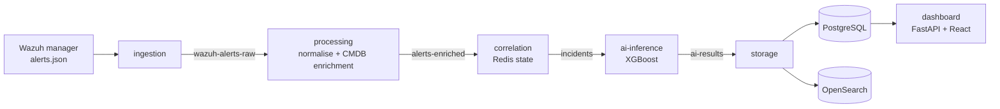

# soc-pipeline

An event-driven Security Operations Center pipeline built on Wazuh. Alerts are streamed through Kafka, normalised and enriched with asset context, correlated into incidents by stateful rules, classified by an XGBoost model, stored in PostgreSQL and OpenSearch, and shown in a web dashboard.

Built as an end-of-studies project on a virtualized lab network (Proxmox, pfSense, Active Directory). It contains no production data. Read [Limitations](#limitations) before reusing any configuration.

## How it works



Each stage is an independent Python service in its own container, decoupled by Kafka topics. Correlation state lives in Redis, outside the persistence layer.

| Service | Role | Kafka in / out |
|---|---|---|
| ingestion | Tails Wazuh `alerts.json` and publishes raw alerts | publishes `wazuh-alerts-raw` |
| processing | Normalises events and enriches them with asset context (hostname, role, criticality) | `wazuh-alerts-raw` to `alerts-enriched` |
| correlation | Applies stateful rules with thresholds and sliding time windows, keeping counters in Redis | `alerts-enriched` to `incidents` |
| ai-inference | Classifies each incident into one of eight classes (seven attack types plus normal activity) with a confidence score | `incidents` to `ai-results` |
| storage | Persists results to PostgreSQL and OpenSearch | consumes `ai-results` |
| dashboard | FastAPI backend serving a React UI: KPIs, incident table with pagination, filtering and search, incident detail view | reads PostgreSQL |

### Correlation rules

Six rules in `services/correlation/correlation_service.py`: brute force (5 matching events in 60 seconds), privilege escalation burst, lateral movement, alert storm, repeated high severity, and reconnaissance (pfSense port scan confirmed by a Wazuh frequency rule). Deterministic rules detect first; the classifier labels the resulting incidents.

## Quick start

Requirements: Docker 24+, Docker Compose v2, 8 vCPU and 8 GB RAM, and a Wazuh manager on the same host writing `alerts.json` (default path `/var/ossec/logs/alerts`).

```bash
git clone https://github.com/bahahamrouni/soc-pipeline.git
cd soc-pipeline
cp .env.example .env     # then set POSTGRES_PASSWORD and REDIS_PASSWORD
make setup
make up
make health
```

The compose file refuses to start without both passwords. Kafka, OpenSearch and the dashboard (port 8000) publish on `127.0.0.1` by default; set `BIND_ADDR` in `.env` to expose them on a lab network.

```bash
make logs s=ingestion    # tail one service
make topics              # list Kafka topics
make status              # show containers
make down                # stop everything
make clean               # delete all data (destructive)
```

## Model and evaluation

The `ai-inference` service loads `/app/model/xgboost_model.pkl` if it exists. If it does not, the service bootstraps a model from synthetic profiles so the pipeline can run end to end. A model trained on real labelled incidents, using the same nine-feature schema the service expects, is produced by `validation/09_train_production_model.py`.

The labelled-data workflow lives in `validation/`:

1. `06_run_logger.py` logs each attack run with exact start and end times (ground truth).
2. `07_build_labeled_dataset.py` labels captured Wazuh alerts by matching them to those windows.
3. `08_train_evaluate.py` trains XGBoost with a leakage-safe split and reports per-class metrics, macro-F1, a majority-class baseline, a rule-only baseline and the false-positive rate on benign traffic.
4. `09_train_production_model.py` builds a training set from real incidents in PostgreSQL for the production schema and evaluates it.

Results from `08_train_evaluate.py` on a 995-sample held-out set:

| Metric | Value |
|---|---|
| Macro-F1 | 0.633 |
| Accuracy | 98.0% (inflated by class imbalance) |
| False positives on the benign holdout | 0 of 163 |

Note: `08_train_evaluate.py` uses its own four-feature schema built from raw alert fields, so these figures do not automatically carry over to the nine-feature model in `ai-inference`. The header of `09_train_production_model.py` explains the difference.

## Live attack validation

Attack scenarios were run from a Kali machine against lab hosts (scripts in `validation/`) and traced from raw alert to dashboard incident: SSH brute force with Hydra, alert storm, lateral movement and privilege escalation. Brute force and alert storm were detected and classified correctly. Lateral movement and privilege escalation were detected but misclassified.

Run these scripts only against systems you own or are authorised to test.

## Limitations

- **Class imbalance.** Brute force dominates the held-out set; several classes have very few or no samples, so macro-F1 is the metric to read.
- **Schema gap.** The evaluated model and the deployed model use different feature schemas (see above).
- **No authentication.** The dashboard API has no login and allows any CORS origin. The `users` table is seeded but unused. Keep it on an isolated lab network.
- **Lab configuration.** Kafka runs in plaintext and OpenSearch has its security plugin disabled. Do not reuse this configuration in production.
- **Throughput not benchmarked.** No load test has been run.

## Roadmap

- Train and deploy the production model from labelled incidents, and mount a model volume
- Authentication for the dashboard API, TLS and authentication for Kafka and OpenSearch
- Larger, balanced labelled dataset and SHAP explainability
- Automated tests and CI

## Repository layout

```
config/       service configuration (Redis)
init/         database schema, seed data, Kafka topics, OpenSearch template
ops/          Wazuh and pfSense setup notes and decoder rules
scripts/      helper scripts
services/     one folder per pipeline service
validation/   attack scenarios, labelled-data workflow, model training and evaluation
```
